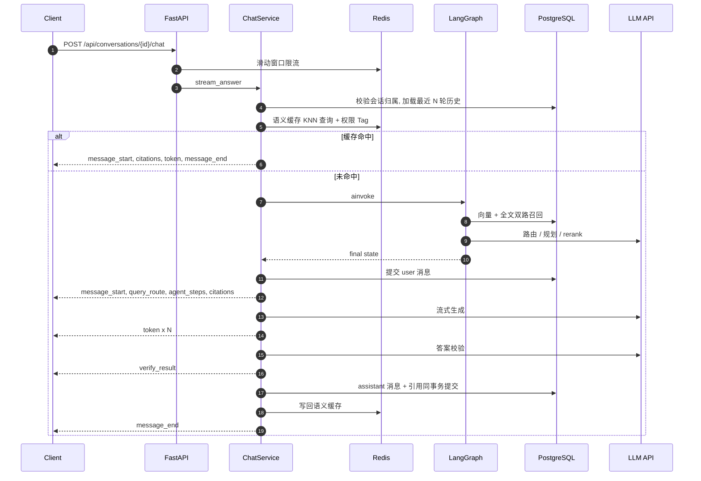
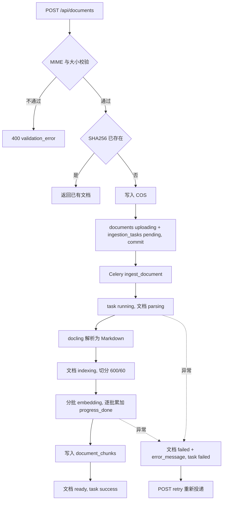
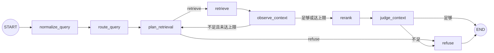

# rag-knowledge-base · 后端

企业知识库 RAG 服务：把 PDF / Office / Markdown / HTML 文档异步入库为可检索的文本块，基于「向量 + 中文全文」混合检索、Rerank 精排和 Agentic 多轮检索回答问题，答案附带可溯源引用，证据不足时拒答，并按 RBAC + 文档权限标签隔离数据。

## 1. 项目简介

面向企业内部制度、手册、流程类文档的问答场景。管理员上传文档后，Celery Worker 负责解析、切分、向量化与写库；用户通过会话（conversation）提问，服务端用 LangGraph 编排查询改写、检索、观察与重排，再以 SSE 流式返回答案、引用（citation）和调试信息。系统内置答案校验、语义缓存、滑动窗口限流、RAGAS 离线评测与 LangSmith 链路追踪。配套前端通过 REST + SSE 消费本服务。

## 2. 核心能力

**知识库管理**

- 支持 PDF、DOCX、PPTX、XLSX、Markdown、HTML 上传，单文件默认上限 50 MB，按文件 SHA256 秒传去重
- Celery 异步入库，`ingestion_tasks` 记录任务状态机与 `progress_total / progress_done` 逐批进度
- 失败文档一键重试；上传新版本时按 `chunk_hash` 对齐做增量 reindex，文档 `version` +1
- 文档重命名（校验扩展名、非法字符、长度）、手动上传缩略图、文本块（chunk）分页与统计

**检索问答**

- 向量（pgvector HNSW，余弦）+ 中文全文（jieba 预分词 + tsvector / GIN）双路并发召回，RRF 融合
- `qwen3-rerank` 精排，Top1 分数低于阈值走统一拒答
- 查询路由：`original` / `rewrite` / `hyde` / `multi_query` / `rewrite_multi_query`；多轮对话先做指代消解
- Agentic RAG：每轮检索后观察上下文是否足够，LLM 规划下一步（改写 / 切换路由 / 拒答），最多 `AGENT_MAX_ROUNDS` 轮
- 答案校验：LLM 判断答案是否有检索片段支撑，不通过整段替换为拒答文案

**权限与安全**

- JWT（HS256）+ bcrypt；每个请求回查用户，禁用立即生效
- RBAC：用户 ↔ 角色多对多，角色持有 `permission_tags`，`*` 为通配
- 文档级权限在 SQL 层过滤；无权文档按 404 返回，不暴露资源存在性
- 语义缓存按「权限集合哈希」隔离；上传 / reindex / 问答挂 Redis 滑动窗口限流

**评测与可观测性**

- 评测集（`app/evaluation/datasets/*.jsonl`）一键跑批，计算 RAGAS 四项指标 + 引用命中率 + 拒答准确率 + 延迟
- 规则自动归因 Bad Case（12 类 + other），支持人工覆盖
- LangSmith `@traceable` 覆盖检索与问答链路，`trace_id` 随 SSE 下发并落库
- 统一异常体 `{"code", "message"}`，统一 stdout 日志格式

## 3. 技术栈与选型理由

版本约束以 `backend/pyproject.toml` / `backend/uv.lock` 为准。

| 领域 | 选型 |
| --- | --- |
| 语言 / 包管理 | Python >= 3.12，uv |
| Web 框架 | FastAPI + Uvicorn，Pydantic v2 + pydantic-settings |
| 数据库 / ORM | PostgreSQL + pgvector，SQLAlchemy >= 2.1 异步 + asyncpg，Alembic |
| 检索 | pgvector HNSW（`vector_cosine_ops`）+ PostgreSQL 全文检索（`simple` 配置 + GIN），jieba 预分词，RRF，qwen3-rerank |
| LLM / 编排 | LangGraph，LangChain Core / langchain-openai，DeepSeek chat（OpenAI 兼容），DashScope `text-embedding-v3`（1024 维） |
| 异步任务 | Celery（Redis broker / result backend） |
| 缓存 / 限流 | Redis + RedisVL 语义缓存，Redis ZSET 滑动窗口 |
| 文档解析 | docling（转 Markdown），Pillow 生成缩略图 |
| 对象存储 | 腾讯云 COS（cos-python-sdk-v5） |
| 评测 | RAGAS + 自定义指标与规则归因 |
| 认证 | PyJWT + bcrypt |
| 可观测性 | LangSmith |

**关键取舍**

1. **混合检索而不是纯向量**。是什么：两路各召回 Top 20 再融合。为什么：制度文档里大量编号、金额、专有名词（如「一线城市」「500 元」），纯语义召回容易漏字面命中，关键词路正好补位。代价：多一次 SQL 和一份 `content_tokens` 存储，jieba 词典质量直接影响关键词路效果。
2. **RRF 而不是分数相加**。余弦相似度在 [0, 1]，`ts_rank` 无固定上界，直接相加没有意义；RRF 只看排名 `1 / (k + rank)`，与分数尺度无关。代价：丢掉了分数绝对值信息，所以拒答阈值改看 rerank 分 / 向量分，而不是 RRF 分。
3. **权限过滤放在 SQL 层**。过滤条件和向量 / 全文检索在同一条 SQL 的 `WHERE` 中执行，Top-K 截断发生在过滤之后，不会出现「召回 20 条、过滤后剩 2 条」导致的召回量塌缩，也不会让无权数据进入应用内存。代价：权限模型必须能表达成数组运算（`&&` / `cardinality`）。
4. **入库走 Celery，评测走 BackgroundTasks**。入库是高频、耗 CPU（docling 模型推理）的长任务，需要独立进程和可横向扩展的 Worker；评测是管理员低频手动触发，用 FastAPI `BackgroundTasks` 免去额外部署。代价：评测与 API 进程同生命周期，重启即中断（见「已知限制」）。
5. **RedisVL 做语义缓存**。复用已有 Redis，KNN + Tag 过滤一次查询完成「相似度阈值 + 权限范围一致」两个条件。代价：缓存命中依赖 embedding 调用，embedding 失败时直接跳过缓存。

## 4. 系统架构

### 4.1 分层职责

| 层 | 目录 | 职责 |
| --- | --- | --- |
| API | `app/api/routes`、`app/api/schemas`、`app/api/deps.py` | 参数校验、鉴权依赖（`CurrentUser` / `CurrentAdmin` / `RateLimited`）、ORM → Pydantic 转换 |
| Service | `app/services` | 业务规则与**事务边界**：`commit` 只出现在 service、pipeline 与后台任务中 |
| Repository | `app/db/repositories` | 单表 / 聚合查询，只 `flush` 不 `commit`，权限过滤条件在这里拼进 SQL |
| Model | `app/db/models.py` | ORM 模型、枚举、索引与外键级联策略 |
| 领域模块 | `app/retrieval`、`app/workflows`、`app/llm`、`app/ingestion`、`app/evaluation`、`app/storage` | 检索、编排、模型调用、入库流水线、评测、对象存储 |

请求级 `AsyncSession` 由 `get_session` 依赖注入；SSE 问答、Celery 任务、评测任务和混合检索各自用 `AsyncSessionLocal()` 开独立 session，不与请求生命周期绑定。

### 4.2 问答时序



### 4.3 入库流程



## 5. 目录结构

```text
backend/
├── app/
│   ├── main.py              # create_app 工厂、lifespan 种子管理员、CORS、异常处理、路由挂载
│   ├── celery_app.py        # Celery 实例与 worker 配置
│   ├── core/                # config / logger / tracing / observability / security / exceptions / redisConfig / rate_limiter
│   ├── api/
│   │   ├── deps.py          # DbSession / CurrentUser / CurrentAdmin / RateLimited
│   │   ├── error_handlers.py
│   │   ├── routes/          # health / auth / users / roles / documents / chat / evaluations
│   │   └── schemas/         # Pydantic 请求 / 响应模型
│   ├── db/
│   │   ├── models.py        # 11 张表的 ORM 模型与枚举
│   │   ├── session.py       # engine / AsyncSessionLocal / get_session
│   │   ├── base.py, seed.py
│   │   └── repositories/    # document / chunk / ingestion_task / conversation / citation / user / role / evaluation
│   ├── services/            # document / chat / auth / user / role / permission / evaluation / semantic_cache
│   ├── retrieval/           # vector / keyword / hybrid(RRF) / tokenizer(jieba) / filters
│   ├── workflows/           # rag_state、graph.py、nodes/*（LangGraph 节点）
│   ├── llm/                 # 模型工厂、prompts、query_rewriter、agent_planner、reranker、answer_verifier
│   ├── ingestion/           # parser / splitter / embedder / thumbnail / pipeline / tasks(Celery)
│   ├── evaluation/          # dataset 加载、ragas_runner、scoring 与归因规则、datasets/*.jsonl
│   └── storage/             # COS 客户端与文件服务
├── alembic/versions/        # 数据库迁移
├── scripts/                 # 维护脚本：backfill_content_tokens
├── vendor/jieba/            # jieba 本地 wheel（uv.toml 通过 find-links 引用）
├── pyproject.toml, uv.lock, uv.toml, alembic.ini
```

`uv.toml` 把 uv 缓存放在 `backend/.uv-cache2`，默认索引为清华镜像，jieba 从 `vendor/jieba/dist` 的本地 wheel 安装（官方只发 sdist）。

## 6. 数据模型

| 表 | 作用 |
| --- | --- |
| `documents` | 文档元数据、COS 位置、状态、版本、权限标签、缩略图 key |
| `document_chunks` | 文本块内容、embedding、分词结果、生成列 `content_tsv` |
| `ingestion_tasks` | 入库 / 重建任务状态与进度 |
| `conversations` | 会话，归属用户 |
| `messages` | user / assistant 消息，`metadata` 存路由、Agent 步骤、校验结果、trace_id、cache_hit |
| `answer_citations` | assistant 消息的引用快照 |
| `users` / `roles` / `user_roles` | RBAC |
| `evaluation_runs` / `evaluation_items` | 评测任务与逐条样本结果 |

**关键设计**

- **向量索引**：`document_chunks.embedding` 为 `vector(1024)`，HNSW + `vector_cosine_ops`。维度来自 `EMBEDDING_DIM`，改维度必须写迁移重建列与索引。
- **全文索引**：`content_tokens` 存 jieba 预分词后以空格连接的文本；`content_tsv` 是 `to_tsvector('simple', content_tokens)` 的持久化生成列 + GIN 索引。用 `simple` 配置是因为 PostgreSQL 内置配置不懂中文分词，分词交给应用层。代价：更换分词规则后要跑 `scripts/backfill_content_tokens.py` 回填。
- **权限标签**：`documents.permission_tags` 为 `text[]`，默认 `{}`。空数组 = 公开；非空数组与用户有效标签做 `&&` 重叠匹配。
- **唯一与版本**：`file_hash` 唯一索引用于秒传；`version` 在 reindex 成功后 +1；`chunk_hash`（内容 MD5）有索引，用于增量对齐。
- **级联策略**：
  - `document_chunks`、`ingestion_tasks` → `documents`：`ON DELETE CASCADE`，删文档一并清理。
  - `messages` → `conversations`、`answer_citations` → `messages`、`evaluation_items` → `evaluation_runs`：`CASCADE`。
  - `documents.created_by`、`conversations.user_id` → `users`：`SET NULL`，删用户不丢文档与会话。
  - `answer_citations.document_id / chunk_id`：`SET NULL`。引用冗余存 `document_name`、`page_no`、`quote`、`retrieval_meta`，原 chunk 被重建或文档被删后，历史会话仍能展示当时的引用原文。
- **任务状态机**：`ingestion_tasks.status` 为 `pending → running → success / failed`，`task_type` 为 `ingest` / `reindex`；文档状态为 `uploading → parsing → indexing → ready / failed`。

## 7. 核心业务流程

### 7.1 文档入库

1. **校验**：扩展名优先于浏览器给的 MIME（`.md` 常被标成 `application/octet-stream`），不支持的类型、空文件、超过 `UPLOAD_MAX_SIZE_MB` 一律 400。
2. **秒传**：按内容 SHA256 查重，命中直接返回已有文档，不重复入库。
3. **落库与投递**：文件写入 COS → 插入 `documents(uploading)` 与 `ingestion_tasks(pending)` → `commit` → `ingest_document_task.delay()`。先提交再投递，Worker 取到任务时数据一定可见。
4. **Worker 执行**（`app/ingestion/pipeline.py::_run_ingest`）：docling 解析 → `RecursiveCharacterTextSplitter`（默认 600 / 60，中文标点分隔符）→ 写 `progress_total` → 按 `EMBEDDING_BATCH_SIZE`（默认 10）分批 embedding，每批独立短事务累加 `progress_done` → 批量写 chunks → `ready` + `success`。每次状态变更都是独立短事务，列表轮询能及时看到进度。
5. **失败与重试**：任一阶段异常 → 文档 `failed` + `error_message`（截断 500 字），任务 `failed`。`POST /{id}/retry` 只接受 `failed` 文档，先清空旧 chunks 再新建任务。
6. **增量 reindex**：要求文档处于 `ready / failed`、MIME 与原文件一致、内容 hash 不同。Worker 按 `chunk_hash` 对齐：旧有新无 → 删除；新旧都有 → 只更新 `chunk_index` / metadata，不重新 embedding；新有旧无 → embedding 后插入，`progress_total` 只计新增数。同一文档内出现重复 `chunk_hash` 时退化为全删全插。成功后 `version` +1。
7. **删除**：处于 `parsing / indexing` 的文档禁止删除。先删 DB 行并提交，再删 COS 对象与缩略图；COS 删除失败只记 warning，以 DB 为准。
8. **列表 N+1 优化**：`GET /documents` 用一条 `SELECT DISTINCT ON (document_id) ... ORDER BY document_id, created_at DESC` 批量取当前页每个文档的最新任务，作为 `latest_task` 返回。

### 7.2 检索问答（LangGraph）



| 节点 | 行为 |
| --- | --- |
| `normalize_query` | 有历史时调用 LLM 做指代消解，得到独立可检索的 `query` |
| `route_query` | 选择 `original / rewrite / hyde / multi_query / rewrite_multi_query`，`QUERY_ROUTE_ENABLED=false` 时固定 `original` |
| `plan_retrieval` | 首轮记录 `initial`；后续轮由 agent planner 决定 `proceed / rewrite_query / switch_route / refuse` |
| `retrieve` | 混合检索；`multi_queries` 存在时逐条子查询检索后按 RRF 分去重合并 |
| `observe_context` | Top1 向量相似度 >= `RETRIEVAL_MIN_SCORE` 视为足够，写回本轮 `retrieved_count / top_score / sufficient` |
| `rerank` | 调用 DashScope rerank，截取 `RETRIEVAL_TOP_K`；调用失败降级为原顺序 |
| `judge_context` | 有 rerank 分看 `RERANK_MIN_SCORE`，否则看向量分；唯一的统一拒答闸门 |
| `refuse` | 置 `refused=True`，答案为固定拒答文案 |

**混合检索细节**（`app/retrieval/hybrid_retriever.py`）：

- 向量路 `cosine_distance` 升序取 `RETRIEVAL_RECALL_TOP_K`（默认 20），关键词路 `websearch_to_tsquery('simple', ...)` + `ts_rank` 降序取同样数量。
- 两路用 `asyncio.gather` 并发，**每路独立 session**：`AsyncSession` 不支持并发执行，共用会污染调用方事务。
- 任一路异常返回空列表，另一路结果照常融合。
- RRF：`score = Σ 1 / (RRF_K + rank)`，`RRF_K` 默认 60，保留两路 rank / score 与命中来源，写入引用的 `retrieval_meta`。
- 权限与元数据过滤（MIME、上传时间、文档 ID）在两路 SQL 的 `WHERE` 中完成。

**生成、校验与落库**（`ChatService.stream_answer`）：

- user 消息在图执行后单独提交，首次提问时用问题前 30 字更新会话标题。
- 非拒答路径逐 token 流式输出；`VERIFY_ANSWER_ENABLED=true` 时用 LLM 校验答案是否由引用支撑，不通过则 `verify_result.replacement_answer` 携带拒答文案，落库内容也替换为拒答。
- assistant 消息与全部引用在**同一事务**提交，保证不会出现「有消息无引用」。
- 任何阶段异常：回滚未提交部分，发 `error` 事件；已提交的 user 消息保留，便于排查与重试。

### 7.3 SSE 事件协议

事件顺序：`message_start → query_route → agent_steps → citations → token × N → [verify_result] → message_end`。拒答路径不发 `verify_result`；语义缓存命中时只发 `message_start → citations → token → message_end`。

| 事件 | 触发时机 | data 关键字段 | 前端用途 |
| --- | --- | --- | --- |
| `message_start` | 图执行完、user 消息落库后；缓存命中时立即发送 | `user_message_id`、`trace_id`、`trace_url`、`cache_hit`（仅缓存命中） | 绑定消息、展示 trace 入口与缓存标记 |
| `query_route` | 紧随 `message_start` | `route`、`query`、`rewritten_query`、`hyde_answer`、`multi_queries` | 路由调试面板 |
| `agent_steps` | 紧随 `query_route` | `steps[]`：`round`、`action`、`reason`、`route`、`query`、`retrieved_count`、`top_score`、`sufficient` | Agent 决策轨迹 |
| `citations` | 生成前 | `citations[]`：`ordinal`、`document_id`、`chunk_id`、`document_name`、`page_no`、`quote`、`score`、`retrieval_meta` | 参考资料面板，`[N]` 角标 |
| `token` | 流式生成中多次；拒答时一次性发送拒答文案 | `delta` | 增量渲染答案 |
| `verify_result` | 生成结束且开启校验 | `verified`、`reason`、`replacement_answer`（仅未通过） | 校验状态，未通过时整段替换答案 |
| `message_end` | 落库完成 | `message_id`、`refused` | 结束流、刷新会话列表 |
| `error` | 任意阶段异常 | `code`（`chat_stream_failed`）、`message` | 错误提示 |

### 7.4 权限与数据隔离

| 用户有效标签 | SQL 过滤条件 | 结果 |
| --- | --- | --- |
| 含 `*`（如 admin 角色） | 不加条件 | 全部文档 |
| `['public', 'hr']` | `cardinality(permission_tags) = 0 OR permission_tags && ARRAY['public','hr']` | 公开文档 + 任一标签重叠的文档 |
| `[]`（无角色或角色无标签） | `cardinality(permission_tags) = 0` | 仅公开文档 |

- 有效标签 = 用户所有角色 `permission_tags` 的并集；任一角色含 `*` 直接返回 `['*']`。
- 管理员身份按**角色名 `admin`** 判定（`is_admin`），与 `*` 标签相互独立：文档列表 / 详情 / chunk 接口对管理员传 `None`（不过滤），问答检索使用标签计算结果。
- 详情、chunk、原文件下载都带权限条件查询，无权按「文档不存在」返回 404。
- 会话按 `user_id` 归属，读、写、删除别人的会话同样返回 404。
- 语义缓存的 Tag 是「排序后的权限标签串」的 SHA256，只有权限集合完全相同的用户才会共享缓存。
- 内置角色 `admin`、`user` 不可删除；管理员不能删除自己。

## 8. API 文档

所有接口前缀 `/api`。权限列：公开 = 无需登录；登录 = Bearer Token；admin = 需 `admin` 角色。「限流」表示挂载 `RateLimited` 依赖。完整字段以 Swagger（`/docs`）为准。

**健康检查**

| 方法 | 路径 | 权限 | 说明 |
| --- | --- | --- | --- |
| GET | `/health` | 公开 | 进程存活 |
| GET | `/health/db` | 公开 | `SELECT 1` |
| GET | `/health/cos` | 公开 | COS 连通性；未配置返回 `not_configured` |

**认证 / 用户 / 角色**

| 方法 | 路径 | 权限 | 说明 |
| --- | --- | --- | --- |
| POST | `/auth/login` | 公开 | 返回 `access_token`、`user`、`permission_tags`、`is_admin` |
| GET | `/auth/me` | 登录 | 当前用户、有效标签、是否管理员 |
| GET | `/users` | admin | 分页列表 |
| POST | `/users` | admin | 创建用户并分配角色 |
| PATCH | `/users/{id}` | admin | 修改昵称、状态、密码 |
| PUT | `/users/{id}/roles` | admin | 全量替换角色 |
| DELETE | `/users/{id}` | admin | 删除用户（不能删自己） |
| GET | `/roles` | admin | 角色列表（数组，不分页） |
| POST | `/roles` | admin | 创建角色 |
| PATCH | `/roles/{id}` | admin | 修改描述 / 权限标签 |
| DELETE | `/roles/{id}` | admin | 删除自定义角色 |

**文档**

| 方法 | 路径 | 权限 | 说明 |
| --- | --- | --- | --- |
| POST | `/documents` | admin + 限流 | **multipart**：`file`，可选 `permission_tags`（JSON 数组字符串） |
| GET | `/documents` | 登录 | 分页 + `status` 筛选，按权限过滤，附 `latest_task` |
| GET | `/documents/{id}` | 登录 | 详情 + 最新任务 |
| PATCH | `/documents/{id}` | admin | 重命名（不可改扩展名） |
| DELETE | `/documents/{id}` | admin | 删除（处理中禁止） |
| POST | `/documents/{id}/retry` | admin | 重试失败文档 |
| POST | `/documents/{id}/reindex` | admin + 限流 | **multipart**：`file`，增量重建 |
| PATCH | `/documents/{id}/permission-tags` | admin | 修改权限标签 |
| GET | `/documents/{id}/file` | 登录 | 原文件；支持 `Authorization` 头或 `?token=`，`download=1` 强制下载 |
| GET | `/documents/{id}/chunks` | 登录 | chunk 分页 + 统计 |
| GET | `/documents/{id}/chunks/{chunk_id}` | 登录 | 单个 chunk 全文 |
| GET | `/documents/{id}/thumbnail` | 公开 | WebP 缩略图（见「已知限制」） |
| PUT | `/documents/{id}/thumbnail` | admin | **multipart**：PDF / JPG / PNG / WebP，<= 10 MB |

**会话问答**

| 方法 | 路径 | 权限 | 说明 |
| --- | --- | --- | --- |
| POST | `/conversations` | 登录 | 创建会话 `{"title"}` |
| GET | `/conversations` | 登录 | 当前用户会话分页，含消息数 |
| GET | `/conversations/{id}` | 登录 | 会话详情与全部消息、引用 |
| DELETE | `/conversations/{id}` | 登录 | 删除会话（204） |
| POST | `/conversations/{id}/chat` | 登录 + 限流 | **SSE**：`{"question", "filters"}`，`filters` 支持 `mime_types`、`created_from`、`created_to`、`document_ids` |

**评测**（整个路由在 router 级挂 `get_current_admin`）

| 方法 | 路径 | 权限 | 说明 |
| --- | --- | --- | --- |
| GET | `/evaluations/datasets` | admin | 评测集名称与条数 |
| POST | `/evaluations/runs` | admin | 创建 run `{"name", "dataset_name"}`，后台执行 |
| GET | `/evaluations/runs` | admin | run 分页 |
| GET | `/evaluations/runs/{id}` | admin | run 详情与汇总指标 |
| DELETE | `/evaluations/runs/{id}` | admin | 删除 run（级联 items） |
| GET | `/evaluations/runs/{id}/items` | admin | case 分页，`bad_case_only`、`category` 筛选 |
| GET | `/evaluations/items/{id}` | admin | 单条 case 详情 |
| PATCH | `/evaluations/items/{id}` | admin | 人工覆盖 `is_bad_case`、`bad_case_category`、`bad_case_note` |

## 9. 快速开始

### 9.1 前置依赖

- Python 3.12+、[uv](https://docs.astral.sh/uv/)
- PostgreSQL，已安装 pgvector 扩展（迁移会执行 `CREATE EXTENSION IF NOT EXISTS vector`，数据库用户需有权限）
- Redis（应用缓存 / 限流、Celery broker、Celery result 分别使用 db0 / db1 / db2）
- 腾讯云 COS 存储桶（上传、下载、缩略图都依赖 COS，代码中没有本地存储实现）
- DashScope API Key（embedding + rerank）、DeepSeek API Key（chat）

### 9.2 环境变量

配置从**仓库根目录**的 `.env` 读取（`app/core/config.py` 中 `PROJECT_ROOT / ".env"`），不是 `backend/.env`。根目录 `.env.example` 只包含少量示例，完整变量见第 10 节。最小可用配置：

```env
DATABASE_URL=postgresql+asyncpg://<db-user>:<db-password>@localhost:5432/<db-name>
REDIS_URL=redis://localhost:6379/0
CELERY_BROKER_URL=redis://localhost:6379/1
CELERY_RESULT_BACKEND=redis://localhost:6379/2

JWT_SECRET=<a-long-random-string>
DEFAULT_ADMIN_PASSWORD=<your-admin-password>

COS_SECRET_ID=<your-cos-secret-id>
COS_SECRET_KEY=<your-cos-secret-key>
COS_REGION=ap-guangzhou
COS_BUCKET=<your-bucket-appid>

EMBEDDING_API_KEY=<your-dashscope-api-key>
CHAT_API_KEY=<your-deepseek-api-key>
```

### 9.3 安装、迁移与启动

```bash
cd backend
uv sync
uv run alembic upgrade head
uv run uvicorn app.main:app --reload --port 8000
```

另开终端启动 Worker：

```bash
cd backend
uv run celery -A app.celery_app worker -l info
```

Windows 上 Celery 默认的 prefork pool 不可用，需要加 `--pool=solo`：

```powershell
cd backend
uv run celery -A app.celery_app worker -l info --pool=solo
```

### 9.4 健康检查

```bash
curl http://127.0.0.1:8000/api/health
curl http://127.0.0.1:8000/api/health/db
curl http://127.0.0.1:8000/api/health/cos
```

Swagger：`http://127.0.0.1:8000/docs`。

### 9.5 最小可用流程

```bash
# 1. 登录，取出 access_token
curl -s -X POST http://127.0.0.1:8000/api/auth/login \
  -H "Content-Type: application/json" \
  -d '{"username": "admin", "password": "<your-admin-password>"}'

export TOKEN=<access_token>

# 2. 上传文档（公开可见），记下返回的 id，轮询 GET /api/documents/{id} 直到 status=ready
curl -s -X POST http://127.0.0.1:8000/api/documents \
  -H "Authorization: Bearer $TOKEN" \
  -F "file=@./差旅管理制度.md" \
  -F 'permission_tags=["public"]'

# 3. 创建会话，记下返回的 id
curl -s -X POST http://127.0.0.1:8000/api/conversations \
  -H "Authorization: Bearer $TOKEN" \
  -H "Content-Type: application/json" \
  -d '{"title": "差旅咨询"}'

# 4. SSE 提问（-N 关闭缓冲，逐事件输出）
curl -N -X POST http://127.0.0.1:8000/api/conversations/<conversation_id>/chat \
  -H "Authorization: Bearer $TOKEN" \
  -H "Content-Type: application/json" \
  -d '{"question": "主管在一线城市出差，每晚住宿报销上限是多少？"}'
```

## 10. 配置说明

以下变量与 `app/core/config.py` 一一对应（大小写不敏感，未知变量忽略）。「必填」指不配置时对应功能不可用。

**基础与数据库**

| 变量 | 必填 | 默认值 | 说明 |
| --- | --- | --- | --- |
| `APP_NAME` | 否 | `rag-knowledge-base` | FastAPI 标题 |
| `LOG_LEVEL` | 否 | `INFO` | 根日志级别 |
| `DATABASE_URL` | 是 | 空 | 必须使用 `postgresql+asyncpg://` 驱动 |
| `CORS_ORIGINS` | 否 | `http://localhost:5173` | 逗号分隔 |

**对象存储**

| 变量 | 必填 | 默认值 | 说明 |
| --- | --- | --- | --- |
| `COS_SECRET_ID` / `COS_SECRET_KEY` | 是 | 空 | 三项均非空才视为已配置 |
| `COS_BUCKET` | 是 | 空 | 存储桶名（含 APPID） |
| `COS_REGION` | 否 | `ap-guangzhou` | 地域 |

**模型**

| 变量 | 必填 | 默认值 | 说明 |
| --- | --- | --- | --- |
| `EMBEDDING_API_KEY` | 是 | 空 | DashScope Key |
| `EMBEDDING_BASE_URL` | 否 | DashScope compatible-mode | OpenAI 兼容地址 |
| `EMBEDDING_MODEL` | 否 | `text-embedding-v3` | |
| `EMBEDDING_DIM` | 否 | `1024` | 必须与 `vector(N)` 列一致 |
| `EMBEDDING_BATCH_SIZE` | 否 | `10` | 每批 embedding 条数，也是进度粒度 |
| `CHAT_API_KEY` | 是 | 空 | DeepSeek Key |
| `CHAT_BASE_URL` | 否 | `https://api.deepseek.com` | |
| `CHAT_MODEL` | 否 | `deepseek-flash` | |
| `RERANK_ENABLED` | 否 | `true` | 关闭后 rerank 节点透传 |
| `RERANK_API_KEY` | 否 | 空 | 留空时回落到 `EMBEDDING_API_KEY` |
| `RERANK_BASE_URL` | 否 | DashScope reranks 端点 | 非标准 OpenAI 接口 |
| `RERANK_MODEL` | 否 | `qwen3-rerank` | |
| `RERANK_MIN_SCORE` | 否 | `0.3` | Top1 rerank 分低于此值拒答 |
| `RERANK_TIMEOUT` | 否 | `8.0` | 秒 |

**切分与检索**

| 变量 | 默认值 | 说明 |
| --- | --- | --- |
| `UPLOAD_MAX_SIZE_MB` | `50` | 单文件上限 |
| `CHUNK_SIZE` / `CHUNK_OVERLAP` | `600` / `60` | 字符数 |
| `RETRIEVAL_RECALL_TOP_K` | `20` | 每路召回数 |
| `RRF_K` | `60` | RRF 平滑常数 |
| `RETRIEVAL_TOP_K` | `5` | rerank 后保留数 |
| `RETRIEVAL_MIN_SCORE` | `0.6` | 向量相似度阈值（observe / 无 rerank 时的 judge） |
| `CHAT_HISTORY_WINDOW` | `5` | 带入 prompt 的历史轮数 |
| `QUERY_ROUTE_ENABLED` | `true` | 关闭后固定 `original` |
| `MULTI_QUERY_COUNT` | `3` | 子查询数 |
| `AGENT_LOOP_ENABLED` | `true` | 关闭后退化为单轮检索 |
| `AGENT_MAX_ROUNDS` | `3` | 最大检索轮次（含首轮） |
| `VERIFY_ANSWER_ENABLED` | `true` | 答案校验开关 |

**认证**

| 变量 | 必填 | 默认值 | 说明 |
| --- | --- | --- | --- |
| `JWT_SECRET` | 是 | 空 | 为空时启动只打 ERROR 日志，登录不可用 |
| `JWT_ALGORITHM` | 否 | `HS256` | |
| `JWT_EXPIRE_MINUTES` | 否 | `1440` | |
| `DEFAULT_ADMIN_USERNAME` | 否 | `admin` | 仅库内无用户时创建 |
| `DEFAULT_ADMIN_PASSWORD` | 否 | `admin` | **生产环境必须覆盖** |
| `DEFAULT_ADMIN_DISPLAY_NAME` | 否 | `管理员` | |

**Redis / Celery / 缓存 / 限流**

| 变量 | 默认值 | 说明 |
| --- | --- | --- |
| `REDIS_URL` | `redis://localhost:6379/0` | 语义缓存与限流 |
| `CELERY_BROKER_URL` | `redis://localhost:6379/1` | |
| `CELERY_RESULT_BACKEND` | `redis://localhost:6379/2` | |
| `SEMANTIC_CACHE_ENABLED` | `true` | |
| `SEMANTIC_CACHE_TTL_SECONDS` | `3600` | |
| `SEMANTIC_CACHE_MIN_SIMILARITY` | `0.92` | 内部换算为距离阈值 `1 - 0.92` |
| `RATE_LIMIT_ENABLED` | `true` | |
| `RATE_LIMIT_PER_MINUTE` | `60` | 按用户，上传 / reindex / 问答共享 |

**LangSmith**

| 变量 | 默认值 | 说明 |
| --- | --- | --- |
| `LANGSMITH_TRACING` | `true` | 需同时配置 Key 才生效 |
| `LANGSMITH_API_KEY` | 空 | |
| `LANGSMITH_PROJECT` | `rag-knowledge-base` | |
| `LANGSMITH_ENDPOINT` | `https://api.smith.langchain.com` | |
| `LANGSMITH_RUN_URL_PREFIX` | 空 | 配置后才下发 `trace_url` |

## 11. 数据库迁移与种子数据

```bash
cd backend
uv run alembic upgrade head                                   # 升级到最新
uv run alembic current                                        # 查看当前版本
uv run alembic history                                        # 查看迁移链
uv run alembic revision --autogenerate -m "<describe-change>" # 修改 models.py 后生成迁移
uv run alembic downgrade -1                                   # 回退一个版本
```

- `alembic/env.py` 使用 `settings.database_url`，与应用共享同一份 `.env`。
- autogenerate 对 pgvector 列、HNSW 索引与 `Computed` 生成列的识别不完整，生成后需人工检查。
- 混合检索迁移（`b7c1e2f3a4d5`）为存量 chunk 填空 `content_tokens`，需要回填：

```bash
cd backend
uv run python -m scripts.backfill_content_tokens
```

**种子数据**：`lifespan` 启动时调用 `seed_default_admin()`，仅当 `users` 表为空时创建内置角色 `admin`（标签 `*`）、`user`（标签 `public`）和默认管理员。种子失败只记录异常，不阻断启动。生产环境首次启动前务必设置 `DEFAULT_ADMIN_PASSWORD` 和 `JWT_SECRET`。

## 12. 评测体系

**数据集**：`app/evaluation/datasets/<name>.jsonl`，一行一个 case。仓库自带 `smoke`（5 条）和 `seed`（50 条），需先上传对应文档。

```json
{"id": "smoke_001", "question": "...", "expected_answer": "...", "expected_document_names": ["差旅管理制度.md"], "expected_keywords": ["500", "一线城市"], "should_refuse": false, "tags": ["差旅"]}
```

**生命周期**：

1. `POST /evaluations/runs` 创建 `running` 状态的 run，并通过 `BackgroundTasks` 执行 `execute_evaluation_run`。
2. 逐条调用 `ChatService.answer_for_evaluation`：完整跑图 + 生成 + 校验，**不写会话表**；每条 case 独立事务写一行 `evaluation_items` 并更新 run 进度。
3. 全部跑完后批量调用 RAGAS 计算 `faithfulness`、`answer_relevancy`、`context_precision`、`context_recall` 并回填。
4. 规则归因 + 聚合到 run：四项均值、`citation_hit_rate`、`refusal_accuracy`、`avg_latency_ms`、`avg_first_token_latency_ms`，状态置 `completed`。
5. 主流程异常时 run 置 `failed` + `error_message`，已写入的 items 保留。

**自定义指标**（`app/evaluation/scoring.py`）：

- 引用命中：任一引用的文档名在期望列表中，或任一期望关键词出现在引用原文中；`should_refuse=true` 的 case 不计算。
- 拒答正确：实际是否拒答 == 期望。

**Bad Case 归因**按「越底层越优先」依次判定，指标低于 0.5 视为低：

| 顺序 | 条件 | 归因 |
| --- | --- | --- |
| 1 | 执行异常 | `other` |
| 2 | 该拒未拒 / 不该拒却拒 | `context_judge_too_loose` / `context_judge_too_strict` |
| 3 | 引用未命中 | `embedding_recall_miss` |
| 4 | `context_recall` 低 | `embedding_recall_miss` |
| 5 | `context_precision` 低 | `rerank_order_error` |
| 6 | `faithfulness` 低 | `generation_off_context` |
| 7 | `answer_relevancy` 低 | `prompt_constraint_weak` |

`document_parse_failed`、`chunk_split_bad`、`keyword_recall_miss`、`rrf_fusion_error`、`citation_parse_failed`、`permission_filter_error` 不会被规则自动命中，留给人工通过 `PATCH /evaluations/items/{id}` 归类。传 `bad_case_category` 会自动置 `is_bad_case=true`；传 `is_bad_case=false` 会清空归因。

## 13. 可观测性与错误处理

- **LangSmith**：`configure_observability()` 在 `create_app` 时把配置同步为 `LANGSMITH_*` 环境变量；开关打开且有 Key 才真正上报，否则强制 `LANGSMITH_TRACING=false`。`ChatService.stream_answer`、`HybridRetriever.search` 等用 `@traceable` 包裹。
- **trace_id 传递**：在 root run 内读取 `trace_id`，写进 `message_start` 事件和 assistant 消息 `metadata`；配置了 `LANGSMITH_RUN_URL_PREFIX` 时额外下发 `trace_url`。读取失败返回 `None`，不影响问答。
- **统一异常体**：

| 异常类 | HTTP | code |
| --- | --- | --- |
| `ValidationError` | 400 | `validation_error` |
| `UnauthorizedError` | 401 | `unauthorized` |
| `PermissionDeniedError` | 403 | `permission_denied` |
| `NotFoundError` | 404 | `not_found` |
| `ConflictError` | 409 | `conflict` |
| `RateLimitedError` | 429 | `rate_limited` |
| `ConfigurationError` | 503 | `configuration_error` |
| 未捕获异常 | 500 | `internal_error`（不回传堆栈） |

```json
{"code": "not_found", "message": "文档不存在"}
```

Pydantic 请求校验失败仍是 FastAPI 默认的 422 `{"detail": [...]}` 格式。

- **日志**：`configure_logging()` 统一输出到 stdout，格式 `时间 | 级别 | logger 名 | 消息`，uvicorn 日志并入根 logger；未捕获异常、检索单路降级、rerank 降级、缓存读写失败都用 `logger.exception` 记录堆栈。

## 14. 工程细节与性能

- **限流**：Redis ZSET 滑动窗口，pipeline（`transaction=True`）原子执行 `ZREMRANGEBYSCORE → ZCARD → ZADD → EXPIRE`，key 为 `rag:rate_limit:user:<id>`，窗口 60 秒。只挂在写接口，避免列表轮询误伤。
- **语义缓存**：命中时跳过整张图和 LLM；只有「非拒答且校验通过」的答案写回。查询和写入失败都按未命中处理，只记日志。
- **连接与 session**：`create_async_engine(pool_pre_ping=True)`，`expire_on_commit=False`、`autoflush=False`。SSE 问答可能持续数十秒，使用独立 session，请求级 session 只做会话归属校验；混合检索两路各开短 session。
- **Celery 配置**：`task_acks_late=False`、`worker_prefetch_multiplier=1`、JSON 序列化、UTC。任务状态以 `ingestion_tasks` 表为准，不依赖 broker 重投；Worker 内用 `asyncio.run` 运行异步流水线。
- **CPU 密集操作**：docling 解析与缩略图生成通过 `asyncio.to_thread` 执行，手动缩略图设 90 秒超时；`DocumentConverter` 全局单例，避免重复加载模型。
- **N+1**：文档列表用 `DISTINCT ON` 批量取最新任务；`User.roles` 用 `selectin` 加载。
- **索引**：HNSW（向量）、GIN（全文）、`file_hash` 唯一、`chunk_hash`、各外键列。
- **事务边界**：上传、重试、reindex 都是「落库 → commit → 投递任务」；问答中 user 消息与「assistant 消息 + 引用」分两个事务；评测每条 case 一个事务。

## 15. 已知限制与后续规划

**现状**

- 仓库没有自动化测试和 CI，也没有 Docker / K8s 编排，按单机部署描述。
- `GET /documents/{id}/thumbnail` 未接入登录与权限校验，知道文档 ID 即可读取缩略图。
- 评测跑批依赖进程内 `BackgroundTasks`：API 重启会中断执行，run 会停留在 `running`；进度只能轮询，没有推送。
- 文档删除、重命名、修改权限等管理操作没有审计日志。
- `REDIS_URL` 等连接串不会自动带密码，连接带密码的实例时需写成 `redis://:<password>@host:6379/0`。
- COS 是唯一的存储实现，未配置时上传、下载、缩略图均不可用（`/health/cos` 返回 `not_configured`）。

**代码核对中发现、待修复的问题**

- `ChatService.stream_answer` 调用 `self.get_conversation(conversation_id, user_id=...)`，而方法签名是 `current_user=`，SSE 问答会抛 `TypeError`。
- `stream_answer` 在图执行结束后又调用了一次 `retrieve(state)`，覆盖了 rerank 后的 Top-K，引用与生成实际使用的是 RRF Top 20。
- Celery 入库路径（`pipeline._run_ingest` / `_make_chunk`）没有写入 `content_tokens`，也没有调用 `_attach_thumbnail`；新入库文档关键词路召回为空、没有自动缩略图，需先跑回填脚本。对应逻辑只存在于未被调用的 `ingest_document()` 中。

**建议**

- 把评测执行迁到 Celery，复用 `ingestion_tasks` 式的状态表，解决重启中断。
- 为 `rrf_fuse`、`scoring.classify_bad_case`、`_permission_where`、增量 reindex 对齐逻辑补单元测试。
- 缩略图接口复用 `/file` 的 Header / `?token=` 鉴权并带权限过滤。
- 管理操作写审计表（操作人、对象、前后值）。

## 16. 常见问题 / 排障

| 现象 | 原因与处理 |
| --- | --- |
| 迁移报 `type "vector" does not exist` 或无权创建扩展 | 数据库未安装 pgvector，或用户没有 `CREATE EXTENSION` 权限；由 DBA 执行一次 `CREATE EXTENSION vector;` |
| Redis 报 `NOAUTH Authentication required` | 连接串缺密码，改为 `redis://:<password>@host:6379/<db>`，三个 Redis 变量都要改 |
| `uv sync` 卡在 jieba 构建或缓存目录无权限 | 必须在 `backend/` 下执行，让 `uv.toml` 生效（本地 wheel + 项目内缓存） |
| 首次解析很慢或下载失败 | docling 首次运行会从 HuggingFace 下载布局 / OCR 模型；网络受限时在 shell 环境变量中设置 `HF_ENDPOINT` 镜像（写在 `.env` 里不会被导出给 SDK）。`backend/artifacts/` 下有本机已下载的模型，代码中未显式引用该目录 |
| 文档一直 `uploading`，任务 `pending` | Worker 未启动或连不上 broker；Windows 需加 `--pool=solo` |
| 浏览器报 CORS 错误 | 将前端源加入 `CORS_ORIGINS`（逗号分隔） |
| 上传返回 400「文件超过 50 MB 上限」 | 调整 `UPLOAD_MAX_SIZE_MB`；如经反向代理，同时调整代理的请求体上限 |
| 登录返回 401「服务端未配置 JWT secret」 | 在根目录 `.env` 设置 `JWT_SECRET` 后重启 |
| Swagger 调用业务接口返回 401 | 鉴权依赖直接读取 `Authorization` 请求头，没有声明 OpenAPI security scheme，Swagger 页面没有 Authorize 按钮；用 curl / Postman 携带 `Authorization: Bearer <token>` 调试 |
| 关键词路始终无结果 | 跑 `uv run python -m scripts.backfill_content_tokens` 回填 `content_tokens` |
