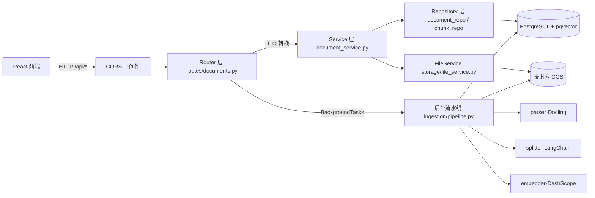
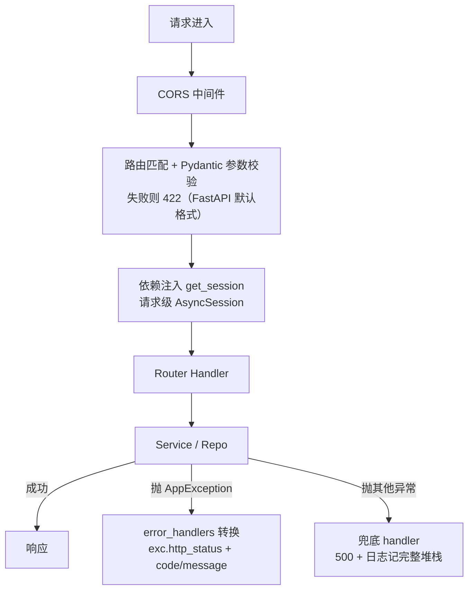
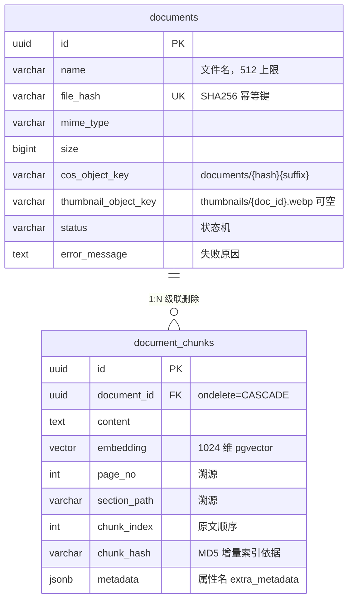
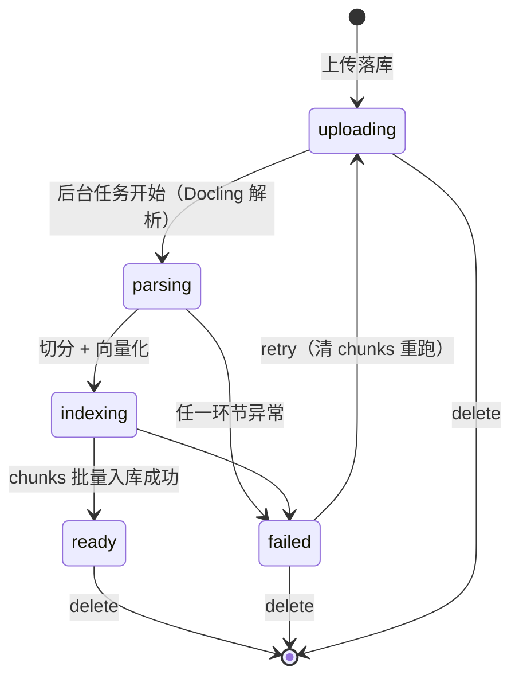
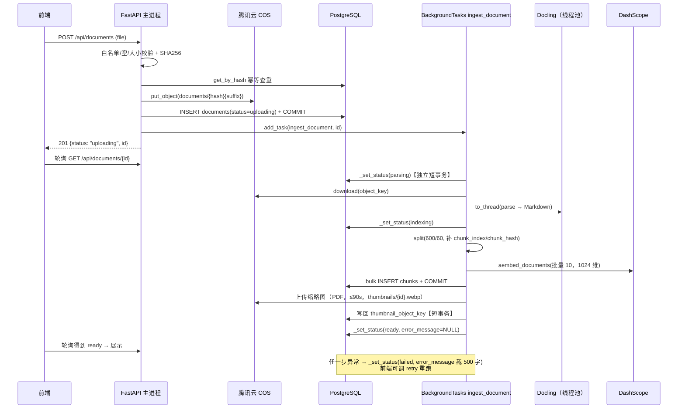

# RAG 知识库 · 后端 API 逆向梳理（文档管理模块）

> 基于 `backend/` 源码逆向整理，用于快速回忆业务逻辑与调用链路。
> 代码基线：master 分支（缩略图上传替换功能已合入）。

## 一、全局识别结果

### 1.1 技术栈

| 层 | 技术 |
|---|---|
| Web 框架 | FastAPI（全异步，应用工厂 `create_app()`，见 `backend/app/main.py`） |
| ORM | SQLAlchemy 2.0 async（`asyncpg` 驱动 + Alembic 迁移） |
| 数据库 | PostgreSQL + pgvector（向量维度 1024，与 `EMBEDDING_DIM` 强绑定，改维度必须走迁移） |
| 对象存储 | 腾讯云 COS（同步 SDK，统一经 `asyncio.to_thread` 包装为异步） |
| 文档解析 | Docling（重模型，进程内单例，线程池执行） |
| 切分/向量化 | LangChain `RecursiveCharacterTextSplitter` + DashScope `text-embedding-v3`（OpenAI 兼容协议） |
| 异步机制 | FastAPI `BackgroundTasks`（进程内，无消息队列） |

### 1.2 路由文件与接口清单（共 14 个）

路由注册：`backend/app/main.py:49-50`，两个 Router 统一挂 `/api` 前缀。

| # | 方法 | 路径 | operation_id | 作用 |
|---|---|---|---|---|
| 1 | POST | /api/documents | uploadDocument | 上传文档（异步解析入口） |
| 2 | GET | /api/documents | listDocuments | 分页列表 |
| 3 | GET | /api/documents/{id} | getDocument | 文档详情（前端轮询状态用） |
| 4 | DELETE | /api/documents/{id} | deleteDocument | 删除（DB + COS） |
| 5 | POST | /api/documents/{id}/retry | retryDocument | 重试失败解析 |
| 6 | GET | /api/documents/{id}/file | downloadDocument | 原文件下载/预览 |
| 7 | GET | /api/documents/{id}/chunks | listDocumentChunks | chunk 分页列表 + 切分统计 |
| 8 | GET | /api/documents/{id}/chunks/{chunk_id} | getDocumentChunk | chunk 完整详情 |
| 9 | GET | /api/documents/{id}/thumbnail | getDocumentThumbnail | 缩略图（WebP） |
| 10 | PATCH | /api/documents/{id} | renameDocument | 重命名 |
| 11 | PUT | /api/documents/{id}/thumbnail | uploadDocumentThumbnail | 手动上传/替换缩略图 |
| 12 | GET | /api/health | healthApp | 应用存活 |
| 13 | GET | /api/health/db | healthDb | 数据库连通（SELECT 1） |
| 14 | GET | /api/health/cos | healthCos | COS 凭据 + head_bucket |

### 1.3 分层架构



模块地图：

```
backend/app/
├── main.py                  # 应用工厂：日志 → CORS → 异常处理器 → 路由
├── api/
│   ├── deps.py              # DbSession 依赖（请求级 AsyncSession）
│   ├── error_handlers.py    # 全局异常 → 统一 JSON 错误体
│   ├── routes/documents.py  # 11 个接口（Controller 层）
│   └── schemas/documents.py # Pydantic DTO（VO 层）
├── core/                    # config(Pydantic Settings) / exceptions / logger
├── db/
│   ├── models.py            # ORM：Document / DocumentChunk / DocumentStatus
│   └── repositories/        # document_repo / chunk_repo（纯数据访问，不 commit）
├── services/document_service.py  # 全部业务编排（校验、状态机、编排 COS）
├── ingestion/               # 后台入库流水线：parser / splitter / embedder / thumbnail / pipeline
└── storage/                 # cos_client（SDK 封装）/ file_service（业务封装）
```

## 二、统一拦截与处理机制（每个请求的公共链路）



| 机制 | 生效环节 | 要点 |
|---|---|---|
| CORS | 最外层中间件 | 白名单来自 `CORS_ORIGINS` 环境变量（默认 `http://localhost:5173`），放行凭证与全部方法/头 |
| 参数校验 | 路由绑定阶段 | Query `ge/le`、路径 UUID、Body `Field(min/max)`。**校验失败返回 FastAPI 默认 422，不经过统一异常包装** |
| DbSession 依赖 | Handler 调用前 | `deps.py`：`Annotated[AsyncSession, Depends(get_session)]`，请求级 session，退出作用域自动关闭；**commit 由 Service 显式调用** |
| 全局异常处理 | Handler 抛异常后 | 两级：`AppException`（业务异常，自带 http_status/code）→ `Exception`（兜底 500，`logger.exception` 记堆栈，对外屏蔽细节） |
| 鉴权拦截器 | **不存在** | 无任何认证/鉴权层；`PermissionDeniedError` 已定义但无人抛出。当前唯一的访问控制是 CORS |

统一业务错误体：`{"code": "...", "message": "..."}`

| 异常类 | HTTP | 触发场景 |
|---|---|---|
| ValidationError | 400 | 文件类型/大小/名称校验失败、状态机非法操作 |
| NotFoundError | 404 | 文档 / chunk / 缩略图不存在 |
| ConfigurationError | 503 | COS 或 Embedding 配置缺失（惰性单例构造时抛出） |
| DocumentParseError | 400 | Docling 解析失败/结果为空（发生在后台任务内，最终落为 FAILED 状态而非 HTTP 响应） |
| 其他一切 | 500 | 兜底处理器 |

## 三、核心数据模型与 DTO 流转

### 3.1 ER 与状态机



状态机（`DocumentStatus`，DB 存小写字符串）：



- **可删除状态 = {ready, failed, uploading}**（`_DELETABLE_STATUSES`）；parsing/indexing 中禁止删除。
- **可重试状态 = {failed}**。

### 3.2 ORM ↔ DTO 的三种转换方式

| 方式 | 场景 | 代码位置 |
|---|---|---|
| `model_validate(orm)` + `from_attributes=True` | Document → DocumentRead，字段一一对应 | 各路由统一出口 |
| 自定义工厂 `from_orm_chunk()` | Chunk 转换需要计算/裁剪：列表接口把 content 截断为 100 字符 `content_excerpt`（超长加 `...`）并另附 `char_count` 全长；详情接口返回完整 content | `schemas/documents.py` |
| ORM `@property` 被 Pydantic 拾取 | `Document.thumbnail_url` 动态拼 `/api/documents/{id}/thumbnail`（无缩略图 → None，前端显示占位图） | `db/models.py:103` |

细节备忘：
- `DocumentStatusValue = Literal["uploading","parsing","indexing","ready","failed"]` 与 ORM 枚举手动同步——专为 openapi-typescript 生成精确字面量类型；入参方向在路由里 `DocumentStatus(status)` 反向转换。
- `DocumentChunk.extra_metadata` 属性 ↔ DB 列名 `metadata`（SQLAlchemy 保留字冲突，`mapped_column("metadata", ...)` 重命名）。
- Repository 层统计用 frozen dataclass `ChunkStats`，路由层再手工映射为 Pydantic `DocumentChunkStats`——dataclass 归仓储、Pydantic 归 API，边界清晰。

## 四、文档管理接口逐一解析

### 4.1 POST /api/documents — 上传文档（最核心）

| 项 | 内容 |
|---|---|
| 方法/路径 | POST `/api/documents`，multipart/form-data |
| 入参 | `file`: UploadFile 必填（校验链见下） |
| 出参 | 201 + `DocumentRead`（status=`uploading`）。**重复上传命中幂等时返回已存在旧记录，同样 201，不报错** |

**校验规则（顺序执行）**：
1. 类型白名单：**后缀优先于 `content_type`**（浏览器对 .md 常误报 `application/octet-stream`）；支持 pdf/docx/pptx/xlsx/md/markdown/html/htm/xhtml；后缀与 MIME 双白名单互查，不匹配 → 400
2. 非空校验 → 400
3. 大小 ≤ `UPLOAD_MAX_SIZE_MB`（默认 50MB）→ 400

**调用链路**：

```
POST /api/documents
└─ CORS → 路由匹配 → 参数校验 → 注入 DbSession
└─ routes/documents.py :: upload_document
   └─ DocumentService.upload(file, background_tasks)
      ├─ _resolve_mime_and_suffix()          # 类型白名单
      ├─ file.read() + hashlib.sha256        # 全量读内存、算指纹
      ├─ DocumentRepository.get_by_hash()    # ★ 幂等查重：命中直接返回旧记录
      ├─ FileService.upload()
      │   └─ CosClient.put_object() → asyncio.to_thread(腾讯云 SDK)   [外部 COS]
      │       key = documents/{sha256}{suffix}   # hash 作 key：同内容天然覆盖
      ├─ DocumentRepository.add() → flush    # INSERT，拿到 UUID 主键
      ├─ session.commit() + refresh          # ★ 必须先 commit 再投递后台任务
      └─ background_tasks.add_task(ingest_document, doc.id)   # 异步解析入口
   └─ DocumentRead.model_validate(document)
```

**为什么这么做**：
- **哈希幂等（秒传）**：SHA256 查重在前，重复文件不重复传 COS、不重复入库，直接复用旧记录；`file_hash` 列 unique 约束兜底。
- **commit 先于 add_task**：后台任务用独立 session 查库，不 commit 就查不到这条记录——上传链路最关键的时序约束。
- 立即返回 `uploading`，前端凭 `id` 轮询 `GET /{id}` 看进度。

### 4.2 ingest_document — 后台入库流水线（上传/重试触发，非 HTTP 接口）

```
BackgroundTasks（响应返回后，同进程内执行）
└─ ingestion/pipeline.py :: ingest_document(document_id)
   ├─ 会话①：读 cos_object_key / name（短事务即关，防 session 关闭后懒加载报错）
   ├─ _set_status(PARSING)                 # 独立短事务，立即 commit → 轮询可见
   ├─ FileService.download(cos_object_key) [COS]
   ├─ parser.parse()                       # Docling 解析 → Markdown
   │   └─ asyncio.to_thread(_convert_sync) # 重 CPU；DocumentConverter 进程内单例
   ├─ _set_status(INDEXING)
   ├─ splitter.split()                     # RecursiveCharacterTextSplitter
   │   # chunk_size=600 / overlap=60 / 中文标点分隔符
   │   # 每 chunk 补 metadata：chunk_index、chunk_hash=MD5(content)
   ├─ embedder.get_embeddings().aembed_documents(texts)
   │   # DashScope text-embedding-v3，1024 维，客户端按 batch=10 自动分批
   ├─ 会话②：DocumentChunkRepository.bulk_add() → commit
   │   # zip(chunks, embeddings, strict=True)：长度不一致立刻抛错，防文本/向量错位
   ├─ _attach_thumbnail()                  # 仅 PDF；to_thread + 90s 超时；独立事务写回 key
   │   # ★ 并发防御：写回时发现文档已被删 → 删掉刚传的 COS 缩略图，避免孤儿文件
   ├─ _set_status(READY, error_message=None)
   └─ except 兜底：_set_status(FAILED, error_message=str(exc)[:500])
```

**为什么这么做**：
- **状态变更用独立短事务**（每次 `AsyncSessionLocal()` 新开）：解析全程可达数分钟，若包成一个大事务，记录被长期锁定且前端轮询看不到中间态。每个阶段即改即提交。
- **重 CPU/同步 SDK 全部 `to_thread`**：Docling、缩略图渲染、COS SDK 都不阻塞事件循环，主服务其他接口不受影响。
- **`zip(strict=True)`**：模型漏返回向量时宁可整个任务 FAILED，也不能把 A 文本配上 B 向量。
- **缩略图是"锦上添花"**：生成失败只 warning 不阻断；但它排在置 READY 之前，复杂 PDF 最多让 READY 推迟 90s。
- **失败信息截断 500 字符**存 `error_message`，前端可直接展示。

### 4.3 GET /api/documents — 分页列表

- 入参：`page`(≥1，默认 1)、`page_size`(1–100，默认 20)、`status?`（五值 Literal，路由内转枚举）
- 链路：`Router → Service.list_documents → DocumentRepository.list_paginated`，两条 SQL：`ORDER BY created_at DESC OFFSET/LIMIT` + `COUNT(*)`（status 条件同时作用于两条）
- 出参：`DocumentListResponse{items[], total, page, page_size}`

### 4.4 GET /api/documents/{id} — 详情

- 路径参数非法 UUID → 框架 422；查不到 → `NotFoundError` → 404 `{code:"not_found"}`
- 上传后前端就是靠它轮询状态机流转

### 4.5 DELETE /api/documents/{id} — 删除（204 无响应体）

```
DELETE /api/documents/{id}
└─ Service.delete()
   ├─ get_by_id → 不存在抛 404
   ├─ 状态校验：status ∈ {ready, failed, uploading}，否则 400 "文档处理中"
   ├─ 先取 object_key / thumbnail_object_key（删库后 ORM 失效）
   ├─ repo.delete(doc) → session.commit()       # ★ DB 先删（真相之源）
   ├─ FileService.delete(object_key)            # COS 后删，失败仅 warning 不上抛
   └─ FileService.delete(thumbnail_object_key)  # 有缩略图则一并删
```

**为什么这么做**：
- **DB 是真相之源，先删 DB**：反过来先删 COS 的话，删库失败会出现"文件没了但列表还在"的更糟状态；先删 DB 后，COS 失败只留孤儿文件（浪费一点存储，不影响正确性），用户得到确定性的成功。
- **状态门禁**：parsing/indexing 中删除会让后台任务写库踩空、产生孤儿 chunks，故拒绝。
- chunks 删除双保险：ORM `cascade="all, delete-orphan"` + FK `ondelete="CASCADE"`（`passive_deletes=True` 交给 DB 执行）。

### 4.6 POST /api/documents/{id}/retry — 重试失败解析

- 状态门禁：仅 `failed` 可重试（防止对 ready/处理中文档重复投递，避免并发写 chunks）
- **防御性清场**：先 `chunk_repo.delete_by_document()` 删残留 chunks——失败任务可能"写了一半"，必须从零开始
- 重置状态机：`status→uploading`、`error_message→None`，commit 后 `background_tasks.add_task(ingest_document)`，返回最新 DocumentRead

### 4.7 GET /api/documents/{id}/file?download=0|1 — 下载/预览

- 入参：`download` 限 0/1（`ge=0, le=1`）
- 链路：`service.get()`（404 兜底）→ `file_service.download(cos_object_key)` 全量 bytes → 裸 `Response`（无 response_model）
- 行为决策：`force_attachment = download==1 or mime==DOCX`（浏览器无法内联渲染 DOCX，强制下载）；其余尝试 `inline` 内联预览
- **中文文件名**：HTTP 头仅限 ASCII，`quote(name, safe="")` + RFC 5987 `filename*=UTF-8''...` 解决乱码
- ⚠️ 全量载入内存，超大文件宜改 `StreamingResponse`（代码注释已自我标注）

### 4.8 GET /api/documents/{id}/chunks — chunk 分页列表 + 统计

- **先校验文档存在**（复用 `service.get`）：否则"空列表"与"文档不存在"前端无法区分
- repo 两条查询：按 `chunk_index ASC` 分页（保证与原文顺序一致，RAG 拼上下文不乱序）+ 单条聚合 SQL（`COUNT/AVG/MIN/MAX(char_length)` 一次拿全；`char_length` 按字符计，对中文友好）
- 出参 items 用 `DocumentChunkRead`：content 截断 100 字符（`content_excerpt`），`char_count` 给全长——列表不回大文本，看全文走 4.9

### 4.9 GET /api/documents/{id}/chunks/{chunk_id} — chunk 详情

- **双条件查询** `WHERE id=? AND document_id=?`（`get_for_document`）：拿 A 文档 id 猜 B 文档的 chunk_id 查不到 → 404，**防水平越权**
- 返回完整 `content`（`DocumentChunkDetail`）

### 4.10 GET /api/documents/{id}/thumbnail — 缩略图

- `thumbnail_object_key` 为空 → 404（前端显示占位图）
- COS 读字节 → `Response(media_type="image/webp", Cache-Control: private, max-age=86400, Content-Disposition: inline)`，浏览器缓存一天

### 4.11 PATCH /api/documents/{id} — 重命名

- Body：`DocumentRenameRequest{name}`（1–255 字符）
- **Service 层九连检**：trim → 非空 → ≤255 → 非 `.`/`..`（防路径遍历）→ 无 `\/:*?"<>|` → 无控制字符(<32) → 不以 `.`/空格结尾（Windows 兼容）→ **后缀必须与原名一致**（防改扩展名绕过类型白名单）→ 同名幂等短路（不写库）
- 通过后改属性 → commit → refresh → 返回 DocumentRead

### 4.12 PUT /api/documents/{id}/thumbnail — 手动上传/替换缩略图

- 校验：后缀 ∈ {pdf, jpg, jpeg, png, webp}、非空、≤10MB
- CPU 处理（`generate_manual_thumbnail`）丢 `to_thread` + `wait_for(90s)` 超时；内部：PDF 源走 Docling 首页渲染；图片源走 Pillow——像素 >4000 万拒绝（防解压炸弹）、EXIF 方向自动矫正
- 统一编码 WebP：宽 >900 等比缩（LANCZOS）、透明通道贴白底、quality=82
- **COS key 固定 `thumbnails/{document_id}.webp`**：重复上传自然覆盖旧图，无需先删后传
- 写回 `thumbnail_object_key` → commit；底层 `ValueError` → 400，其余异常包装为友好提示并记完整堆栈

### 4.13 健康检查（3 个，速览）

| 接口 | 逻辑 | 状态值 |
|---|---|---|
| GET /api/health | 静态返回 | ok |
| GET /api/health/db | `SELECT 1` | ok / error（带原因） |
| GET /api/health/cos | 先查 `cos_configured`（三项凭据非空），再 `head_bucket` ping | ok / error / not_configured |

## 五、异步任务全生命周期（上传 → Ready 完整时序）



**三条铁律**（看懂这张图的关键）：
1. **每个状态迁移 = 一个独立短事务**，即改即 commit——前端轮询实时可见，DB 不被长事务锁死。
2. **后台任务永远用 `AsyncSessionLocal()` 新建 session**，与 HTTP 请求的 session 无关——所以投递前必须先 commit。
3. **失败不抛给 HTTP 层**（任务在响应返回后才执行），统一落为 `status=failed + error_message`，修复手段是 retry 接口。

## 六、设计决策速查表（"为什么"索引）

| 设计点 | 位置 | 动机 |
|---|---|---|
| SHA256 幂等秒传 | upload | 重复文件不重复存储；hash 兼作 COS key，同内容天然覆盖 |
| 后缀优先于 MIME | `_resolve_mime_and_suffix` | 浏览器对 .md 常误报 octet-stream |
| commit 先于 add_task | upload / retry | 后台任务用独立 session，不 commit 查不到记录 |
| 状态机短事务 | `_set_status` | 长任务进度可见 + 不锁库 |
| DB 先删、COS 后删 | delete | DB 是真相之源；COS 失败仅留孤儿文件 |
| 删除状态门禁 | `_DELETABLE_STATUSES` | parsing/indexing 中删会踩空后台任务 |
| retry 前清 chunks | retry | 失败可能"写一半"，从零重跑 |
| chunk 双条件查询 | `get_for_document` | 防水平越权 |
| `zip(strict=True)` | pipeline | 文本与向量严格对齐，错位宁可失败 |
| 缩略图失败不阻断 | `_attach_thumbnail` | 非核心功能只 warning；写回前查文档是否还在，防孤儿 COS 文件 |
| 固定缩略图 key | `thumbnails/{id}.webp` | 替换即覆盖，免先删 |
| 中文文件名 RFC5987 | download | HTTP 头 ASCII 限制 |
| 重对象单例 | DocumentConverter×2 / Embeddings / CosClient | 初始化昂贵，全局复用 |

## 七、已知边界与风险（逆向时发现，回忆时留意）

1. **无鉴权层**：所有接口裸奔，仅 CORS 挡浏览器；`PermissionDeniedError` 无人使用。
2. **上传查重存在竞态窗口**：`get_by_hash` 是 check-then-act，并发上传同一文件时第二个请求会撞 unique 约束 → IntegrityError → 500（数据不损坏，但报错不友好）。
3. **后台任务进程内执行**：无持久化队列，进程重启会把 parsing/indexing 的文档永久卡住（且该状态禁止删除）——需人工改库或加启动恢复扫描。
4. **/file 全量载入内存**：大文件高并发有内存压力，宜改流式响应。
5. **READY 被缩略图阻塞**：`_attach_thumbnail` 在置 READY 之前执行，复杂 PDF 最多让文档晚 90 秒变为可检索。
6. **422 未统一包装**：Pydantic 参数校验失败走 FastAPI 默认格式，与业务错误体 `{code, message}` 不一致，前端需兼容两种。

---

*待续模块：前端调用侧（`frontend/src/api/documents.ts` + hooks 轮询逻辑）；RAG 检索/问答模块（尚未实现，`document_chunks.embedding` 已就绪）。*
